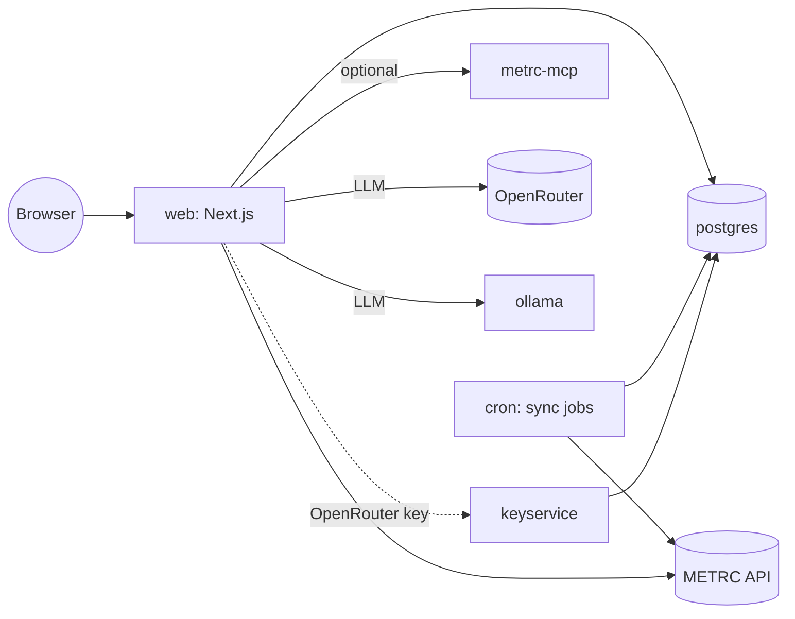

# Architecture

## Components

- **web**: the Next.js app (UI, tRPC API, authentication, AI Copilot). Published on `PORT`; the container listens on 3000.
- **migrate**: one-shot job that applies database migrations (and bootstraps LLM providers on first start) before `web` and `cron` start. It only runs against `DATABASE_URL`; a separate `DASHBOARD_DATABASE_URL` is not migrated and is unsupported.
- **cron**: runs the METRC sync jobs on the `CRON_SYNC_DAILY`, `CRON_SYNC_FULL` and `CRON_SYNC_SALES` schedules.
- **postgres**: the only required datastore (volume `pgdata`). Facility keys are stored encrypted with `METRC_ENCRYPTION_KEY`.
- **metrc-mcp** (profile `mcp`): MCP server exposing METRC tools; it receives only the METRC and OpenRouter settings, not platform secrets.
- **ollama** (profile `ollama`): local LLM runtime for the Copilot.
- **redis** (profile `cache`): optional cache.
- **keyservice** (profile `keyservice`): holds one shared OpenRouter key, encrypted in its own `keyservice` database on the same Postgres.

## Data flow

Sync jobs pull data from METRC for each facility and store snapshots in
Postgres. Dashboards, compliance rules and analytics read those snapshots. The
Copilot's tools also read the snapshots, and its prompts go to the configured
provider (OpenRouter with anonymized prompts, or local Ollama). Setting
`METRC_PLATFORM_ENABLED=false` disables the platform features.
